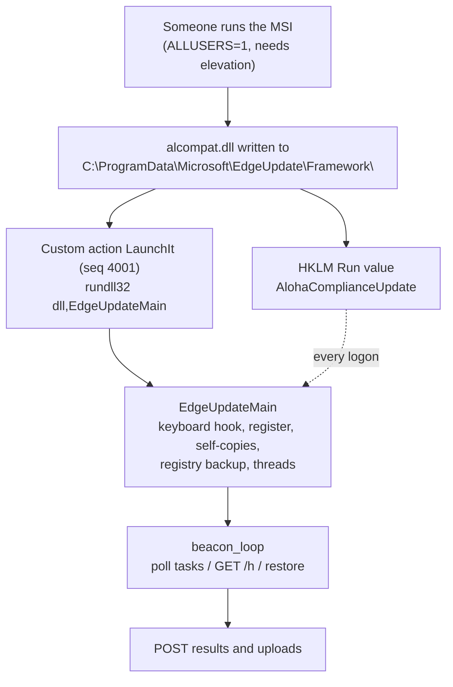
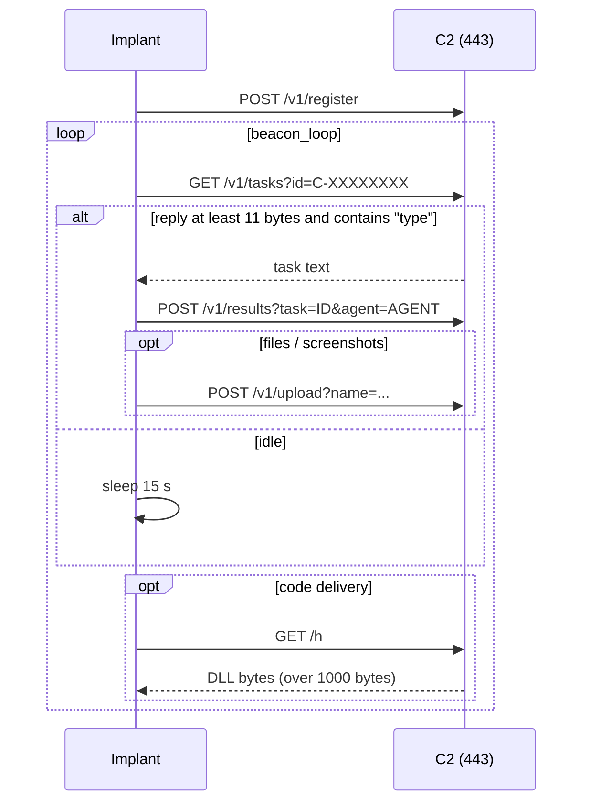

# Aloha POS Compliance Update: Technical Analysis of a POS-Targeting Backdoor

**Author:** Mohamed Matter · **Date:** 2026-10-15 · **Method:** static analysis only (the sample was never executed)

A fake "Aloha POS Compliance Update" MSI installs `alcompat.dll`, an unpacked 64-bit MinGW backdoor that disguises itself as Microsoft Edge Update. It polls `test.qovexira[.]xyz` over HTTPS for tasks and supports shell commands, screenshots, hidden-desktop control, keylogging, browser-file theft, POS data collection (including a magnetic-stripe track parser), LAN spreading with credentials, code replacement and self-removal. The author left the symbol table in, which exposes 51 internal function names and about 40 globals.

This document covers everything I confirmed. Statements are tagged **[traced]** (I read the disassembly of the code that does it), **[table]** (read from MSI tables or PE structures) or **[string]** (the string or symbol exists, the code that uses it was not traced). Anything tagged **[string]**, and the items called out as "not traced" inline, are not confirmed behavior.

## Contents

1. [Key findings](#1-key-findings)
2. [Sample](#2-sample)
3. [Infection chain and delivery](#3-infection-chain-and-delivery)
4. [Stage 1: the MSI dropper](#4-stage-1-the-msi-dropper)
5. [Stage 2: the implant](#5-stage-2-the-implant)
6. [Persistence and self-healing](#6-persistence-and-self-healing)
7. [C2 protocol](#7-c2-protocol)
11. [POS and credential theft](#11-pos-and-credential-theft)
13. [Self-removal](#13-self-removal)
14. [Metadata left in the binary](#14-metadata-left-in-the-binary)
17. [IOCs](#17-iocs)

---

## 1. Key findings

- **Two stages, one outbound connection.** The MSI only drops the DLL, adds a Run value and launches it. All behavior lives in the DLL. No exploit is used anywhere. **[table, traced]**
- **Pull-based C2.** The implant registers with `POST /v1/register`, then polls `GET /v1/tasks?id=<agent>` about every 15 s and returns results over HTTPS on port 443. Every request carries the header `X-Edge-Update: opbZMeJMJZmmveM7Nnck3g`. Certificate errors are ignored. **[traced]**
- **The built-in updater is not running.** `update_loop` and `check_for_update` exist but nothing in this sample starts them, so `GET /v1/update` is never sent. Code is replaced through `GET /h` (a reply over 1,000 bytes is saved as `%TEMP%\alha_upd.dll` and started with `rundll32 ...,EdgeUpdateMain`) and through the `download` / `deploy` task. No integrity check exists on either. **[traced]**
- **Heavy redundancy.** At launch the DLL copies itself to six places, stores a base64 copy of itself in the registry value `UpdateCache`, and a watchdog and the beacon loop can restore it. **[traced]**
- **Keylogging starts at launch** through a low-level keyboard hook whose API (`SetWindowsHookExW`) is resolved at run time and absent from the import table. **[traced]**
- **POS focus is real.** Process-name role detection (`server` / `terminal` / `desktop`), a scheduled RAM scrape at lunch and dinner hours, an Aloha / Toast path list, and a parser for magnetic-stripe track 1 and track 2 text. The memory scraper body was not traced. **[traced / string]**
- **Self-throttling around security products.** A watcher thread sets a flag when it sees SentinelOne, Defender, CrowdStrike, Carbon Black or Symantec process names; the RAM scrape and the one-shot operations read that flag. The implant does not try to kill the products. **[traced]**
- **Lateral movement is credential-based**, not an exploit: `net use` to `C$`, copy the DLL, create and run a remote scheduled task. **[traced]**
- **Self-removal exists** (`exit` / `panic` task) but leaves several artifacts behind. **[traced]**
- **The metadata gives away the design.** All 51 author function names are in the symbol table. DWARF is present only for the mingw runtime, so there are no author source files, line numbers or local variable names. **[table]**
- **Delivery is unknown.**

## 2. Sample

| | MSI installer | Payload DLL |
|---|---|---|
| SHA256 | `f79292fdbe66d33305321dcc51049b53c8f075d39a3f1324dba2e5258d36fec1` | `e02e39f6c06f23f448c483cab0c4cad7be0b65522133bd34994aab9a6fb6cae9` |
| MD5 | `dd9be2e3c7b04a417908f337aec9b539` | `e36cf4e2fa6fa9ba4bd853d9b7768ef4` |
| Size | 200,704 bytes | 449,435 bytes |
| Format | OLE compound file (MSI), WiX 3.14.1.8722 | PE32+ x86-64 DLL, MinGW-w64 (GCC 16.1.0), not packed, unsigned |
| Built | 2026-10-13 10:38:54 (summary stream) | 2026-10-13 09:38:27 UTC (PE timestamp) |
| Self-description | "Aloha POS Compliance Update", author "Aloha POS", 2.0.0.1 | "Microsoft Edge Update Service" 1.3.145.7, original name `msedgeUpdater.exe` |
| Identifiers | ProductCode `{A5EBEC60-626A-4E21-A0E2-A479167F1700}`, UpgradeCode `{7A3B9C2D-4E5F-6A7B-8C9D-0E1F2A3B4C5D}` | imphash `31d833fbf6b2de9a2b0d31caa11a632c`, one export `EdgeUpdateMain` |

Source: MalwareBazaar (AES ZIP, password `infected`). Timestamps can be forged.

## 3. Infection chain and delivery



Nothing in the files shows how the MSI reaches a victim. Searches for the hash, the domain and the installer name found no public report, and a circulated claim about fake "update portal" domains could not be verified, so it is not used. The installer does not check for Aloha or Toast, so it installs on any Windows host it is run on.

## 4. Stage 1: the MSI dropper

Read with `msidump` / `msiextract`. **[table]**

| Table | Content | Effect |
|---|---|---|
| Property | `ALLUSERS=1`, ProductName "Aloha POS Compliance Update", Manufacturer "Aloha POS", 2.0.0.1 | Per-machine install, needs admin |
| Directory | `INSTALLFOLDER` = `CommonAppDataFolder\Microsoft\EdgeUpdate\Framework` | `C:\ProgramData\Microsoft\EdgeUpdate\Framework` |
| File / Component | One file `alcompat.dll` (449,435 bytes), component `AlohaDll` | Only payload |
| Registry | `HKLM ...\CurrentVersion\Run` `AlohaComplianceUpdate` = `rundll32.exe "[INSTALLFOLDER]alcompat.dll",EdgeUpdateMain` | Starts at every logon |
| CustomAction | `LaunchIt`, type 3298, `rundll32.exe "[INSTALLFOLDER]alcompat.dll",EdgeUpdateMain` | Launch during install |
| InstallExecuteSequence | `LaunchIt`, `NOT Installed`, sequence 4001 | Runs right after `InstallFiles` (4000), first install only |
| LaunchCondition | `NOT WIX_DOWNGRADE_DETECTED` | Blocks downgrades only |
| Media | One embedded cabinet `cab1.cab` | Holds the DLL |

## 5. Stage 2: the implant

### 5.1 PE facts **[table]**

PE32+ x86-64 DLL, GUI subsystem, 20 sections, image base `0x2682a0000`, entry RVA `0x1210`, one export `EdgeUpdateMain` (RVA `0xb500`). MinGW-w64 under MSYS2 (`D:/W/B/src/...`, GCC 16.1.0 `-O2 -g`). Not packed (`.text` entropy 6.24), no certificate. The overlay (offset 331,776, 117,659 bytes) is the COFF symbol and string table, not a hidden payload. The version resource impersonates "Microsoft Edge Update Service".

### 5.2 Imports and hidden APIs

Imports cover hidden desktops and capture (`CreateDesktopA`, `SetThreadDesktop`, `BitBlt`, `GetDIBits`, Media Foundation), input (`SendInput`), WinHTTP, process snapshots and memory reading (`ReadProcessMemory`, `VirtualQueryEx`), privileges and registry, ARP and sockets, and base64 (`CryptStringToBinaryA`, `CryptBinaryToStringA`). Two key APIs are **not imported**: `RegSetValueExA` and `SetWindowsHookExW` are resolved at run time into `g_pfn_RegSetValueExA` and `g_pfn_SetWindowsHookExW`, so import-based triage shows no registry writes and no hook. Most process launches also go through `g_pfn_CreateProcessA`. **[traced]**

### 5.3 Startup sequence of `EdgeUpdateMain` **[traced]**

1. `srand(GetTickCount())`; `GetConsoleWindow` + `ShowWindow`.
2. Agent ID `C-%08X` from `GetTickCount`; `GetComputerNameA`, `GetUserNameA`.
3. Installs a `WH_KEYBOARD_LL` (id 13) hook with `kb_hook_routine`.
4. `register_with_c2`.
5. Copies its module file to `%TEMP%\alha_upd.dll` and `%ProgramData%\Microsoft\EdgeUpdate\Framework\msedgeUpd.dll`.
6. Starts `watchdog_thread`.
7. Copies itself again to `...\systemprofile\...\INetCache\IE\alha.dat`, the all-users Startup folder as `desktop.ini`, `%TEMP%\alh_backup.dat` and `C:\Windows\Temp\alcompat.cab`, calling `SetFileAttributesA` on each (attribute value not decoded).
8. Base64-encodes its own file and stores it as `HKLM\SOFTWARE\Microsoft\Windows\CurrentVersion\Explorer\UpdateCache`.
9. Starts `scanner_watch_thread`, `auto_ops_thread`, `peak_hours_thread`, then runs `beacon_loop` forever.

A second entry point, **`WinMain`**, runs the same implant as an EXE: same keyboard hook, registration, `delayed_persistence_thread`, `run_ch`, then `beacon_loop` (no self-copies, no registry backup).

## 6. Persistence and self-healing

| Mechanism | Detail | Status |
|---|---|---|
| MSI Run value | `AlohaComplianceUpdate` = `rundll32.exe "<dll>",EdgeUpdateMain` | table |
| Self-heal | `self_heal_persistence` recreates `AlohaComplianceUpdate`; called from `beacon_loop` and `auto_ops_thread` | traced |
| Second Run value | `install_persistence` writes a Run value (name assembled from fragments; `ToastPOSSystemUpdate` is the name the `exit` task deletes) and launches the DLL. Triggered by the `persist` task and, on the EXE path, by `delayed_persistence_thread` after 8 minutes | traced |
| Six self-copies | Step 5 and 7 above | traced |
| Registry copy | `UpdateCache`: `beacon_loop` reads it (at least 100 bytes), base64-decodes it, writes a file and starts `rundll32 "<path>",EdgeUpdateMain` | traced |
| Watchdog | `watchdog_thread` builds the same `rundll32` command; trigger not traced | partly |
| Re-registration | After at least 6 idle polls and 5 minutes since the last one, `register_with_c2` runs again | traced |

Clean-up note: removing the file and the Run values is not enough while `UpdateCache`, the copies or a running instance remain.

## 7. C2 protocol

All of this is from the code that builds requests and parses replies. **No server reply was captured.**

**Transport [traced].** WinHTTP, user agent `Mozilla/5.0`, host `test.qovexira[.]xyz` port 443 (UTF-16 literal in `http_get` and `http_post`), security flags `0x1100` (ignore unknown CA and CN mismatch), timeouts resolve/connect 10 s and send/receive 30 s. Header `X-Edge-Update: opbZMeJMJZmmveM7Nnck3g` on every request. POSTs use `Content-Type: application/octet-stream` even for JSON. No encryption beyond TLS.

| Method | Path | Purpose |
|---|---|---|
| POST | `/v1/register` | Register |
| GET | `/v1/tasks?id=<agent>` | Fetch a task |
| POST | `/v1/results?task=<id>&agent=<agent>` | Result |
| POST | `/v1/upload?name=<file>` | Raw bytes (screenshots, files) |
| POST | `/v1/upload?name=result_<id>&freeform=1` | Result text |
| GET | `/h` | Code delivery: a reply over 1,000 bytes is saved as `%TEMP%\alha_upd.dll` and run with `rundll32 ...,EdgeUpdateMain` |
| GET | `/v1/update?agent=&ver=` | Latent; never sent in this build |

Also in the binary, purpose not traced: `/v1/live/input?id=` (likely HVNC input).



**Register body:**

```json
{"id":"C-0012AB34","hostname":"<host>","username":"<user>","domain":"","os":"windows","arch":"amd64","pid":1234}
```

**Task parsing.** A reply is a task only if it is at least 11 bytes and contains `"type"`. `process_task` then searches for the substrings `"id":"`, `"type":"`, `"args":"` and `"command":"`. It is substring search, not a JSON parser, so field order does not matter and values end at the next double quote. Finished task IDs are remembered and repeats are logged as `[task] dedup skip`. Illustrative task (reconstructed from the parser, not captured):

```json
{"id":"1001","type":"shell","command":"whoami"}
```

**Result body:** `{"output":"<escaped>","status":"done"}` (`"`, `\`, newline and tab escaped; empty output is `(empty)`).

## 11. POS and credential theft

**Traced.**

- `format_card_tracks` parses raw text: track 1 begins `%B` and ends at `?` (PAN is the text up to `^`), track 2 begins `;` plus a digit and ends at `?`. Output `T1: ... PAN: ...`, `T2: ...`, or `no track data found in raw input`. It parses text that something else must supply; on its own it reads no memory.
- `steal_browser_creds` reads the Chrome and Edge `Login Data` files from `%LOCALAPPDATA%` and uploads them as `chrome_logins_<name>_<tick>.bin` (raw SQLite, no decryption seen).
- `run_ch` collects Wi-Fi profile names from `...\NetworkList\Profiles` and checks for the Chrome `Login Data` file.
- The RAM scrape is scheduled for local lunch and dinner hours (about 11:30 to 13:30 and 17:30 to 19:59, decoded from the time comparisons) on hosts whose role is not `desktop`, and only while no security-product process was seen. Its body (`pos_ram_scrape_run`) was not traced; `ReadProcessMemory`, `VirtualQueryEx`, the symbol `format_card_tracks` and the output name `posram_%lu.bin` indicate what it is for.

**String only.** Aloha, IBER, Toast, Posera and Posiflex data folders and databases (`C:\Aloha\DATA`, `C:\ProgramData\Toast\database.db`, `com.toasttab.pos\database.db`, ...), output templates (`aloha_%d_%s`, `txint_%d.txt`, `terms_%d.txt`, `toast_db_%d.bin`, `toast_prefs_%d.xml`), LSASS strings (`lsass.exe`, `dbghelp.dll`, `SeDebugPrivilege`, `lsa_%d.dmp`), browser `Cookies`, and a list of POS process names (Aloha, Micros, Simphony, Toast, Square, Clover, Lightspeed, TouchBistro, Aldelo, Agilysys, Heartland, SpotOn, Foodics and more).

## 13. Self-removal

Task `exit` or `panic` **[traced]**: delete the Run values `ToastPOSSystemUpdate` and `AlohaComplianceUpdate` (HKCU and HKLM), then start hidden

```
spawn: ping -n 2 127.0.0.1 >nul & del /q "<module path>" & schtasks /delete /f /tn MicrosoftEdgeUpdateTaskMachineCoreX >nul 2>&1
```

and `ExitProcess`. As far as the handler shows, it does not remove the other five copies, the `UpdateCache` value or the log and output files, so a host cleaned this way still carries artifacts.

## 14. Metadata left in the binary

The COFF symbol table (5,060 raw entries, 1,186 unique named symbols) holds **51 author functions in one contiguous block** and about 40 globals. DWARF sections exist but describe only the mingw-w64 C runtime (37 compile units); none of the 51 functions is in DWARF, so there are no author source file names, line numbers, types or local names. With readable strings and the import table, a decompiler gives output close to the original logic.

A list of 51 function names attributed to a Vx-Underground post (as relayed to me; I did not fetch the post) matches this sample **exactly**: every name is present and the sample has no other author function. The C2 domain quoted in that post also matches.

Selected functions:

| Group | Functions |
|---|---|
| Core | `beacon_loop`, `process_task`, `register_with_c2`, `send_result`, `http_get`, `http_post`, `exec_command`, `read_file`, `write_file`, `dbglog` |
| Persistence | `install_persistence`, `self_heal_persistence`, `delayed_persistence_thread`, `watchdog_thread` |
| Updates | `check_for_update`, `update_loop` (not started) |
| Hidden desktop | `hvnc_task`, `hvnc_spawn_app`, `hvnc_stream_thread`, `hvnc_input_thread`, `upq_worker` |
| Keylogging | `kb_hook_start`, `kb_hook_routine`, `kb_buf_read` (hook is installed inline at startup) |
| POS | `detect_pos_role`, `pos_module_run`, `pos_mod_op_7`, `pos_ram_scrape_run`, `pos_db_dump_run`, `pos_lsa_dump_run`, `pos_aloha_info_run`, `pos_port_sweep_run`, `pos_terminal_run`, `pos_ensure_drop_dir`, `pos_upload_file`, `format_card_tracks` |
| Credentials | `steal_browser_creds`, `run_ch` |
| Network | `lanspread_smb_push`, `lan_collect_neighbors`, `lanmon_capture`, `run_pivot_scan` |
| Awareness | `scanner_watch_thread`, `peak_hours_thread`, `auto_ops_thread` |
| Unreferenced here | `update_loop`, `kb_hook_start`, `get_system_info`, `generate_agent_id`, `implant_upload_file`, `kb_buf_read`, `is_btc_address`, `is_eth_address` |

Globals of interest: `g_scanner_active`, `g_done_tasks` (dedup list), `g_drop_dir`, `g_hvnc*`, `g_pfn_CreateProcessA` / `g_pfn_RegSetValueExA` / `g_pfn_SetWindowsHookExW`, `kb_buf_a`, `g_autoops.0` to `.4`.

**How the public description compares:** keylogging, registration and HVNC capability are confirmed; security-product handling is real but is throttling, not evasion by blinding; card theft is confirmed at the track-parser level and inferred for the memory scraper; the lateral movement is credential-based rather than an exploit. Statements about the author's tooling (for example AI assistance) cannot be shown from the binary.

## 17. IOCs

Defanged where needed. All indicators come from the sample itself; none was seen in the wild.

| Type | Indicator |
|---|---|
| SHA256 | `f79292fdbe66d33305321dcc51049b53c8f075d39a3f1324dba2e5258d36fec1` (MSI), `e02e39f6c06f23f448c483cab0c4cad7be0b65522133bd34994aab9a6fb6cae9` (DLL) |
| Domain | `test.qovexira[.]xyz` (port 443) |
| Header | `X-Edge-Update: opbZMeJMJZmmveM7Nnck3g` |
| Paths | `/v1/register`, `/v1/tasks?id=C-`, `/v1/results?task=`, `/v1/upload?name=`, `/h` |
| Registry | Run values `AlohaComplianceUpdate`, `ToastPOSSystemUpdate`; `HKLM\SOFTWARE\Microsoft\Windows\CurrentVersion\Explorer\UpdateCache` |
| Task | `MicrosoftEdgeUpdateTaskMachineCoreX` |
| Files | `...\EdgeUpdate\Framework\alcompat.dll`, `msedgeUpd.dll`, `%TEMP%\alha_upd.dll`, `%TEMP%\alh_backup.dat`, `C:\Windows\Temp\alcompat.dll`, `C:\Windows\Temp\alcompat.cab`, `...\INetCache\IE\alha.dat`, Startup `desktop.ini` |
| Command line | `rundll32.exe "<dll>",EdgeUpdateMain` |
